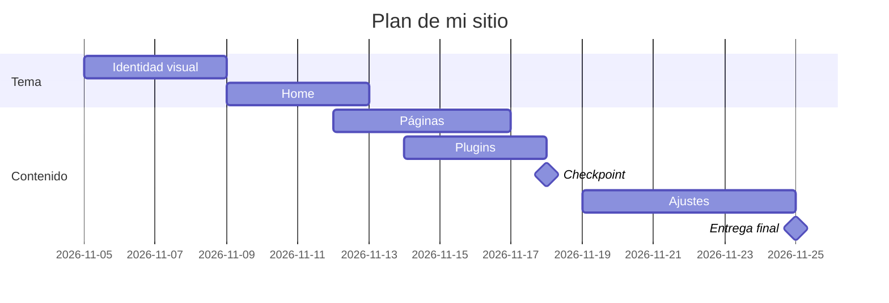

# Decisiones de mi sitio

**Emprendimiento:** Nabi Skin
**Fecha:** 25 Noviembre · **Última corrección:** (fecha)

## 1. Plugins (10 pts)

Al menos **5 plugins**, cada uno vale 2 pts. **SEO** y **contacto** son obligatorios; los otros 3 los eliges según lo que necesita tu sitio (parte de `docs/03-funcionalidades.md`). Guía: `guia-investigar-plugins.md`.

| # | Funcionalidad | Plugin | Gratis o de pago | Qué incluye la versión gratis | Probado hasta (WP) | Requiere PHP | ¿Funciona con tema propio? | Enlace a la ficha |
|---|---|---|---|---|---|---|---|---|
| 1 | SEO (obligatorio) | Yoast SEO | Gratis (con versión Pro opcional) |Análisis de legibilidad, título SEO y meta descripciones.  | Probado hasta la versión actual | Sí | Sí | Yoast SEO Plugin |
| 2 | Contacto (obligatorio) | Contact form 7 | Gratis | Creación de formularios personalizados y gestión de envíos.  | Probado hasta la versión actual | Sí | Sí | Contact Form 7 |
| 3 | Copia de seguridad | BackWPup | Gratis (versión Pro disponible) | Respaldos completos de base de datos y archivos del sitio. | Probado hasta la versión actual | Sí | Sí | BackWPup |
| 4 | Filtro de Spam | Akismet Anti-spam | Gratis (planes comerciales opcionales) | Filtrado automático de comentarios de spam. | Probado hasta la versión actual | Sí | Sí | Akismet Anti-spam |
| 5 | Newsletter / Suscripción | Mailchimp for WordPress | Gratis (versión Pro disponoble) | Formularios de suscripción enlazados a listas de correo. | Probado hasta la versión actual | Sí | Sí | Mailchimp for WordPress |

## 2. Páginas de la fase 1 (5 pts)

**5 páginas**, 1 pt cada una. **Inicio** y **Contacto** son obligatorias; las otras 3 las eliges (no pueden ser del carro de compras).

| # | Página | Por qué la elijo (una línea) |
|---|---|---|
| 1 | Inicio (obligatoria) | Cumple con la funcionalidad principal de presentar la marca y captar la atención. |
| 2 | Contacto (obligatoria) | Es obligatoria y permite que los clientes resuelvan dudas directas sobre los productos de K-Beauty o sus envíos. |
| 3 | Nosotros | Es clave para transmitir la filosofía de la marca y generar confianza en pieles sensibles. |
| 4 | Blog | Espacio dedicado a educar a los usuarios mediante artículos sobre el cuidado de la piel y la doble limpieza coreana. |
| 5 | Preguntas frecuentes (FAQ) | Resuelve de forma rápida las dudas más comunes sobre los tipos de piel, envíos a Chile y métodos de pago. |

**Páginas que dejo para después:** (lista corta)

## 3. Plan del tema (5 pts)

- **Nombre del tema:** Kadence
- **Custom o descargado:** Descargado, porque ahorra tiempo y es eficiente.
- **Carta Gantt** del desarrollo del sitio (5 al 25 de noviembre). Puedes usar esta tabla o un diagrama Mermaid.

| Etapa | Desde | Hasta | Notas |
|---|---|---|---|
| Identidad visual | 2026-11-05 | 2026-11-08 | Definición de logotipo y colores. |
| Home | 2026-11-09 | 2026-11-11 | Estructura y diseño de la página principal. |
| Páginas | 2026-11-12 | 2026-11-13 | Creación de Nosotros, Contacto, Blog y FAQ. |
| Plugins | 2026-11-14 | 2026-11-17 | Instalación y configuración de los 5 plugins. |
| **Checkpoint (18 nov)** | 2026-11-18 | 18 nov | Revisión de avances y corrección de errores. |
| Ajustes y formulario | 2026-11-19 | 2026-11-24 | Pruebas finales de diseño y formularios. |
| **Entrega final (25 nov)** | 2026-11-25 | 25 nov | Publicación definitiva del sitio web. |

Ejemplo con Mermaid (GitHub lo muestra como gráfico):

## 4. Plan B (5 pts)

Qué hago si algo no funciona. **Al menos 3 riesgos**, cada uno con su mitigación y cuándo se activa.

| Riesgo | Qué hago | Cuándo se activa (fecha o señal) |
|---|---|---|
| Problemas de conexión con InfinityFree (Error 500) | Espero unos minutos y reintento; si persiste, continuo desarrollando de manera local en Local | Si el sitio o el panel de hosting dejan de responder por más de 1 hora. |
| Un plugin falla o rompe el diseño | Desactivo el plugin conflictivo desde el panel o por FTP y busco una alternativa anotada. | Al instalarlo o actualizarlo si genera errores críticos. |
| El correo del formulario de contacto no llega | Reviso la configuración SMTP o cambio temporalmente a una notificación en pantalla de éxito. | Antes del checkpoint del 18 de noviembre tras realizar pruebas de envío. |

## Cambios respecto de la Sumativa 2 (solo en el checkpoint del 18 nov)

| Qué cambié | Qué había antes | Por qué | Evidencia (captura o commit) |
|---|---|---|---|
| Actualización de la versión de WordPress | Versión anterior de WP | Para lograr compatibilidad y permitir el funcionamiento correcto del plugin de contacto en el sitio |  |
| Integración de página de Contacto con formulario | Estructura básica de contacto | Para cumplir con los requisitos de interacción y habilitar el canal directo con clientes | Captura de página operativa en InfinityFree |

**Decisión:** Continúo con mi propuesta para **Nabi Skin**, validando que la solución técnica del formulario de contacto quedó operativa tras resolver la actualización del sistema.
